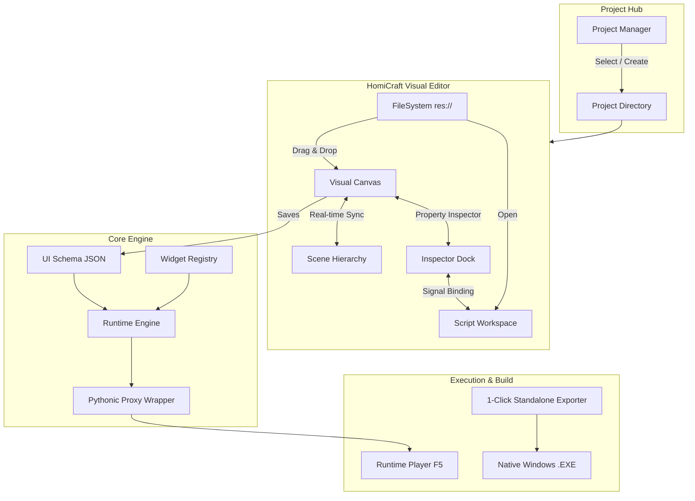

# ⚡ HomiCraft — Complete Developer Manual & Documentation

Welcome to the definitive documentation for **HomiCraft**, the visual software development engine for creating native desktop applications with Python and PySide6 (Qt).

---

## 📑 Table of Contents

- [⚡ System Architecture Overview](#-system-architecture-overview)
- [📖 Chapter Index (Modular Guides)](#-chapter-index-modular-guides)
- [🚀 1. Getting Started & Project Manager](#1-getting-started--project-manager)
- [🎨 2. Visual Editor & Canvas Guide](#2-visual-editor--canvas-guide)
- [🐍 3. Pythonic Scripting & Lifecycle](#3-pythonic-scripting--lifecycle)
- [⚡ 4. Signals & Event Handling](#4-signals--event-handling)
- [💻 5. Code Editor & Autocompletion Engine](#5-code-editor--autocompletion-engine)
- [📦 6. 1-Click Standalone Exporter (.EXE)](#6-1-click-standalone-exporter-exe)
- [🎨 7. Catppuccin Theming & UI Styling](#7-catppuccin-theming--ui-styling)
- [📚 8. Complete API & Widget Reference](#8-complete-api--widget-reference)
- [⚡ Quick Reference & Code Recipes](#-quick-reference--code-recipes)
- [🔄 Documentation Maintenance Guidelines](#-documentation-maintenance-guidelines)

---

## ⚡ System Architecture Overview

HomiCraft unifies visual design and Python logic through a decoupled, declarative architecture:



---

## 📖 Chapter Index (Modular Guides)

For focused reading, this manual is split into standalone modular guides in the [`docs/`](file:///C:/Users/ocean/Documents/GitHub/HomiCraft/docs) directory:

1. [**01: Getting Started & Project Manager**](file:///C:/Users/ocean/Documents/GitHub/HomiCraft/docs/01_getting_started.md) — Launching via EXE/Python, creating projects, templates, project structure.
2. [**02: The Visual Editor Interface**](file:///C:/Users/ocean/Documents/GitHub/HomiCraft/docs/02_editor_guide.md) — Visual canvas, grid snap, hierarchy, inspector, docks, layout customization.
3. [**03: Scripting Guide & Lifecycle**](file:///C:/Users/ocean/Documents/GitHub/HomiCraft/docs/03_scripting_guide.md) — `_ready(app)`, `app.<widget>`, direct node injection, pythonic properties.
4. [**04: Signals & Event Handling**](file:///C:/Users/ocean/Documents/GitHub/HomiCraft/docs/04_signals_and_events.md) — Connecting signals visually, auto-scaffolding, writing callback functions.
5. [**05: Code Editor & Autocompletion**](file:///C:/Users/ocean/Documents/GitHub/HomiCraft/docs/05_code_editor_and_autocompletion.md) — Syntax highlighting, fuzzy autocomplete, badges (`[w]`, `[K]`), dot completion.
6. [**06: Exporting Standalone Applications**](file:///C:/Users/ocean/Documents/GitHub/HomiCraft/docs/06_exporting_standalone_apps.md) — 1-click PyInstaller exporter, windowed vs console mode, distribution.
7. [**07: Catppuccin Theming & UI Styling**](file:///C:/Users/ocean/Documents/GitHub/HomiCraft/docs/07_catppuccin_theming.md) — Mocha, Macchiato, Frappé, Latte, rounded UI, custom CSS/QSS.
8. [**08: Complete API & Widget Reference**](file:///C:/Users/ocean/Documents/GitHub/HomiCraft/docs/08_api_and_widget_reference.md) — Properties, methods, and signals for all 8 standard widgets.

---

## 1. Getting Started & Project Manager

### Launching the Application
- **Executable Mode**: Run `dist\HomiCraft\HomiCraft.exe` or `HomiCraft_Portable_SingleFile.exe`. No Python setup required!
- **Python Source Mode**: Run `python homi_editor.py`.

### The Project Manager Hub
When launched without arguments, HomiCraft displays the Project Manager:
* **✏️ Edit Project**: Opens the project in the visual IDE.
* **▶ Run Standalone**: Executes the app directly without loading the editor.
* **➕ New Project**: Wizard supporting **Empty Project** or **Counter & Controls Demo** templates.
* **📂 Import / Scan**: Scan any directory to add existing projects.
* **📝 Rename Project**: Safely rename projects and auto-update `project.json`.
* **🔍 Show in Explorer**: Open the project folder in Windows File Explorer.
* **🗑️ Remove from List / 💥 Delete Files**: Clean up the recent list or permanently delete project files.
* **🏠 Return to Hub**: Click "🏠 Projects" in the editor toolbar anytime to return to the hub.

---

## 2. Visual Editor & Canvas Guide

### The Visual Canvas
- **Adding Widgets**: Click any widget in the **Widgets Palette** (`Button`, `Label`, `LineEdit`, `TextEdit`, `CheckBox`, `Slider`, `ProgressBar`, `Panel`).
- **Moving & Snapping**: Drag widgets across the canvas. Snaps to 10px grid (toggleable in toolbar).
- **Pixel-Nudge**: Use Arrow keys for 10px steps, or **Shift + Arrow keys** for 1px micro-adjustments.
- **Resizing**: Drag the bottom-right corner handle.
- **Duplicating**: Press **`Ctrl + D`** to clone with an auto-incremented ID.
- **Deleting**: Press **`Delete`** or **`Backspace`**.
- **Double-Click**: Instantly jumps to the script editor and scaffolds the callback.

### Dragging Nodes into Scripts
- Drag any node from the **Scene Hierarchy** dock directly into your script:
  - Dropped on a blank line: inserts `btn_1 = app.btn_1`
  - Dropped inside an expression: inserts `app.btn_1`

### Persistent Dock Layouts & Custom Arrangements
- **Automatic Layout Memory**: Any rearrangement of docks (tabbing panels, moving docks to sidebars, detaching floating panels, adjusting splitters, or resizing the main window) is automatically saved into persistent user preferences (`%APPDATA%\HomiCraft\Layout.ini`).
- **Seamless Session Restores**: When you close the editor and re-open it, or switch between projects, your exact customized layout is restored.
- **📐 Reset Layout**: Click "📐 Reset Layout" in the toolbar anytime to safely un-float, untabify, and return all docks to their default positions.

### ⚙️ Dedicated Settings Window (`Ctrl + ,`)
- **UI & Text Scaling**: Configure interface scaling from **50% to 250%** (Windows Scale equivalent) with live preview.
- **Appearance**: Select Catppuccin theme (Mocha, Macchiato, Frappé, Latte) and code editor font/size.
- **Canvas & Grid**: Configure grid snap step sizes (2px to 64px) and toggles.
- **Workspace Preferences**: Auto-save on run (F5), remember dock layout, and clear saved layout cache.

---

## 3. Pythonic Scripting & Lifecycle

### The `_ready` Lifecycle Hook
Called automatically on all attached scripts when the window and widgets finish initializing:
```python
def _ready(app):
    print("Application initialized!")
    app.lbl_title.text = "Hello HomiCraft"
```

### Direct Node Injection
In addition to `app.<node_id>`, HomiCraft injects every widget proxy directly into the global script scope:
```python
# Both lines work identically:
app.lbl_counter.text = "42"
lbl_counter.text = "42"
```

### Pythonic Properties (Getters & Setters)
```python
button.text = "Click Me"
button.enabled = False
slider.value = 85
checkbox.checked = True
progress.value = 50
input_box.placeholder = "Enter email..."
button.style = "background-color: #a6e3a1; border-radius: 8px;"
```

### Variables, Scopes & Script Outline Panel
* **Module Variables**: If declaring top-level variables (`text1 = "Nothing Here"`), functions that modify them must declare `global text1`.
* **App State (`app.state`)**: Recommended state storage dictionary shared across all callbacks without needing `global`.
* **Script Outline & Variables Panel**: Collapsible panel on the left of the script editor showing all declared variables and functions, with 1-click `➕ Variable` and `➕ Function` wizards.

---

## 4. Signals & Event Handling

Signals connect user interface interactions to Python code without boilerplate.

### Supported Signals
* **Button**: `clicked`, `pressed`, `released`
* **LineEdit**: `textChanged`, `returnPressed`
* **TextEdit**: `textChanged`
* **CheckBox**: `toggled`
* **Slider**: `valueChanged`
* **ProgressBar**: `valueChanged`

### 1-Click Visual Signal Wiring
1. Select a widget on the canvas.
2. In the Property Inspector, click any signal in the **⚡ Signals** section.
3. Choose the target script and method name (e.g. `_on_btn_save_clicked`).
4. Click **Connect & Code**. The method scaffold is generated automatically in your script:
```python
def _on_btn_save_clicked(app):
    # TODO: Handle 'clicked' event
    app.lbl_status.text = "Data saved successfully!"
```

---

## 5. Code Editor & Autocompletion Engine

The built-in Script Workspace provides a rich Python editing environment:
- **Multi-Tab Interface**: Edit multiple scripts side by side.
- **Catppuccin Syntax Highlighting**: Colorized keywords, strings, comments, numbers, and functions.
- **Auto-Indentation**: 4-space auto-indent after `:` and smart backspace un-indentation.

### Intelligent Autocompletion Popup
* **Fuzzy Substring Matching (`MatchContains`)**: Typing `imp` surfaces `import`, `ImportError`, `__import__`, `NotImplemented`, etc.
* **Category Badges**:
  - `[K]` Keyword
  - `[f]` Function
  - `[C]` Class
  - `[E]` Exception
  - `[w]` **Live Scene Node** (Dynamically synced as you add/remove widgets!)
  - `[p]` Property
  - `[s]` Code Snippet
  - `[v]` Variable
* **Contextual Dot Completion**:
  - Typing `app.` lists all widgets in your scene.
  - Typing `<widget_id>.` lists all properties (`text`, `value`, `enabled`) and Qt methods (`click()`, `setFocus()`).
* **Keyboard Controls**: `Ctrl+Space` to trigger, `Tab` / `Enter` to complete, `Up` / `Down` to navigate, `Escape` to dismiss.

---

## 6. 1-Click Standalone Exporter (.EXE)

Package your project into a native Windows executable with zero Python runtime required on client machines:
1. Click **📦 Export .EXE** in the main toolbar.
2. Select **Windowed** (pure GUI) or **Console** (debug terminal).
3. Select an optional `.ico` application icon.
4. Click **📦 Export**.
5. The complete standalone folder is built in `dist/<ProjectName>/` containing `<ProjectName>.exe` and its `_internal/` dependency bundle.

---

## 7. Catppuccin Theming & UI Styling

HomiCraft ships with all 4 official Catppuccin palettes:
* 🌿 **Mocha** (Deep Dark)
* ☕ **Macchiato** (Medium Dark)
* 🍨 **Frappé** (Soft Dark Pastel)
* 🥛 **Latte** (Crisp Light Theme)

### Rounded Modern UI Design
* Rounded corners (`8px` - `12px`) on all buttons, input fields, docks, and menus.
* Custom CSS/QSS support per widget via the Inspector's **Style (CSS)** property or dynamically via `widget.style = "..."` in Python.

---

## 8. Complete API & Widget Reference

### Summary of Standard Widgets

| Widget | Default Size | Primary Properties | Primary Signals |
| :--- | :--- | :--- | :--- |
| **Button** | `120 x 36` | `text`, `enabled`, `style` | `clicked`, `pressed`, `released` |
| **Label** | `140 x 30` | `text`, `alignment`, `style` | — |
| **LineEdit** | `180 x 34` | `text`, `placeholder`, `readOnly` | `textChanged`, `returnPressed` |
| **TextEdit** | `240 x 120` | `text`, `placeholder`, `readOnly` | `textChanged` |
| **CheckBox** | `120 x 30` | `text`, `checked`, `enabled` | `toggled` |
| **Slider** | `160 x 24` | `value`, `min`, `max` | `valueChanged` |
| **ProgressBar** | `180 x 24` | `value`, `min`, `max` | `valueChanged` |
| **Panel** | `250 x 180` | `style` | — |

### `HomiAppContext` Methods
* `app.<widget_id>`: Access widget proxy.
* `app.state`: Persistent application-wide state dictionary.
* `app.window`: Underlying `QMainWindow` instance.
* `app.close()`: Close application window.

---

## ⚡ Quick Reference & Code Recipes

### Recipe 1: Incremental Counter
```python
def _ready(app):
    app.state["count"] = 0
    app.lbl_count.text = "0"

def _on_btn_inc_clicked(app):
    app.state["count"] += 1
    app.lbl_count.text = str(app.state["count"])

def _on_btn_reset_clicked(app):
    app.state["count"] = 0
    app.lbl_count.text = "0"
```

### Recipe 2: Form Validation
```python
def _on_input_email_text_changed(text, app):
    if "@" in text and "." in text:
        app.btn_submit.enabled = True
        app.input_email.style = "border: 2px solid #a6e3a1; border-radius: 8px;"
    else:
        app.btn_submit.enabled = False
        app.input_email.style = "border: 2px solid #f38ba8; border-radius: 8px;"
```

### Recipe 3: Synchronizing Slider with Progress Bar
```python
def _on_slider_volume_value_changed(value, app):
    app.progress_volume.value = value
    app.lbl_volume_percent.text = f"{value}%"
```

---

## 🔄 Documentation Maintenance Guidelines

Whenever a new feature, widget, or capability is added to HomiCraft:
1. **Update the relevant guide in [`docs/`](file:///C:/Users/ocean/Documents/GitHub/HomiCraft/docs)** (e.g. `docs/08_api_and_widget_reference.md` for new widgets, or `docs/02_editor_guide.md` for new canvas tools).
2. **Update this master manual (`DOCUMENTATION.md`)** to reflect the new capabilities, architecture changes, and quick recipes.
3. **Synchronize both directories**: Ensure all changes are mirrored between `C:\Users\ocean\Documents\GitHub\HomiCraft` and `H:\SoftwareDev\HomiCraft`.
